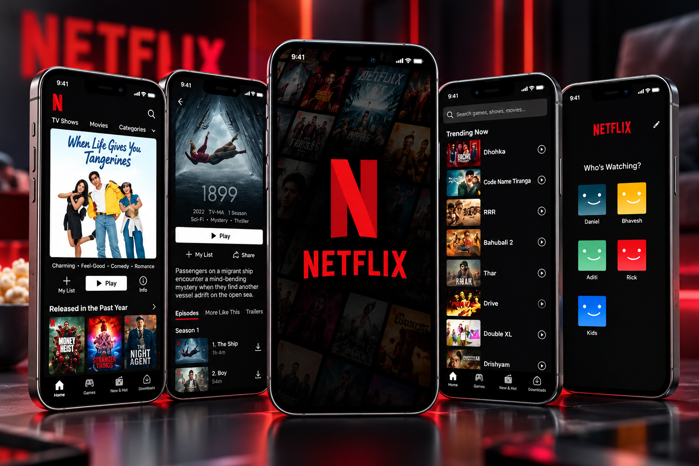

<div align="center">

# 🎬 Movie App — Flutter

### Flutter • Dart • Movie Discovery • Modern UI

A modern **Movie Discovery Application** developed using Flutter and Dart, designed to provide an engaging interface for exploring movies, viewing movie information, and discovering entertainment content.

The project demonstrates Flutter UI development, reusable components, and responsive mobile application design.


</div>

---

## 📸 Project Preview

<div align="center">

<a href="d785a046-41c9-478d-abd1-3307163e5ea7.png">
  
</a>

</div>

---

## 📖 About the Project

**Movie App** is a Flutter-based application focused on creating an attractive and intuitive movie browsing experience.

The project explores how entertainment content can be presented through modern mobile interfaces, organized movie listings, and detailed movie information.

It showcases practical Flutter development skills, including UI composition, navigation, responsive layouts, and reusable widgets.

---

## ✨ Key Features

### 🎥 Movie Discovery

- Browse movie collections.
- Explore different movie titles.
- View movie posters and artwork.
- Discover movies through a visually organized interface.

### 🎬 Movie Information

- View movie titles.
- Explore movie descriptions and details.
- Display movie posters.
- Present movie-related information in a clean layout.

### 📱 Mobile Experience

- Intuitive movie browsing interface.
- Organized movie cards.
- Easy navigation between sections.
- Responsive Flutter layouts.
- User-friendly visual design.

### 🎨 Modern UI/UX

- Entertainment-focused design.
- Attractive movie posters.
- Consistent typography and spacing.
- Reusable Flutter widgets.
- Clean and organized layouts.
- Modern Material Design components.

---

## 🛠️ Technologies Used

| Technology | Purpose |
|------------|---------|
| Flutter | Cross-platform application development |
| Dart | Application logic |
| Material Design | User interface components |
| Git | Version control |
| GitHub | Source code hosting |

---

## 🏗️ Application Overview

```text
                Movie App
                    |
                    v
               Flutter UI
                    |
                    v
              Movie Catalog
                    |
                    v
              Movie Listings
                    |
                    v
              Movie Selection
                    |
                    v
              Movie Details
```

This diagram represents the intended movie browsing experience, not a verified internal code architecture.

---

## 📱 Application Screens

| Screen | Description |
|--------|-------------|
| Home Screen | Browse and discover movies |
| Movie Listings | Explore available movie titles |
| Movie Details | View information about selected movies |
| Navigation | Move between application sections |

---

## 📂 Project Structure

Based on the repository listing:

```text
Movie-App/
│
├── android/
├── ios/
├── lib/
├── linux/
├── macos/
├── test/
├── web/
├── windows/
│
├── d785a046-41c9-478d-abd1-3307163e5ea7.png
├── .gitignore
├── .metadata
├── analysis_options.yaml
├── pubspec.yaml
├── pubspec.lock
└── README.md
```

### Main Directories

**`lib/`**

Contains the application's Dart source code.

**`android/` and `ios/`**

Mobile platform configuration.

**`web/`, `windows/`, `linux/`, `macos/`**

Flutter platform project files.

**`test/`**

Application testing directory.

**`pubspec.yaml`**

Contains project dependencies and asset configuration.

---

## 🚀 Getting Started

### Prerequisites

Make sure you have installed:

- Flutter SDK
- Dart SDK
- Android Studio or VS Code
- Git
- Android emulator or physical device

### 1. Clone the Repository

```bash
git clone https://github.com/AhmedJaberAhmed/Movie-App.git
```

### 2. Navigate to the Project

```bash
cd Movie-App
```

### 3. Install Dependencies

```bash
flutter pub get
```

### 4. Check Available Devices

```bash
flutter devices
```

### 5. Run the Application

```bash
flutter run
```

### 6. Run Tests

```bash
flutter test
```

---

## 💡 Development Highlights

This project demonstrates experience in:

- Flutter mobile application development.
- Dart programming.
- Building entertainment-focused interfaces.
- Displaying structured movie content.
- Creating reusable UI components.
- Responsive application design.
- Mobile navigation.
- Organizing Flutter project files.

---

## 🎯 Project Goals

- Build an attractive movie discovery interface.
- Practice Flutter and Dart development.
- Create reusable and responsive UI components.
- Improve mobile application navigation.
- Present movie content in a user-friendly way.

---

## 🔮 Potential Future Improvements

- 🔍 Advanced movie search.
- ❤️ Favorite movies and watchlists.
- ⭐ Movie ratings and reviews.
- 🎞️ Movie trailers.
- 🎭 Genre-based filtering.
- 🌐 Live movie API integration.
- 🔔 Upcoming movie notifications.
- 🌙 Light and dark themes.
- 📱 Improved tablet layouts.
- 🎯 Personalized movie recommendations.

---

## 👨‍💻 Developer

**Ahmed Jaber Ahmed**

Flutter Developer | Mobile App Developer

B.Sc. Computer Science & Artificial Intelligence

📍 Cairo, Egypt

- [GitHub](https://github.com/AhmedJaberAhmed)
- [Portfolio](https://ahmedjaberahmed.github.io/Jaber-website/)
- [LinkedIn](https://www.linkedin.com/in/ahmedjaberahmed/)

---

<div align="center">

### ⭐ Support the Project

If you find this project interesting, consider giving it a star!

**Built with Flutter 💙 and Dart 🎯**

</div>
